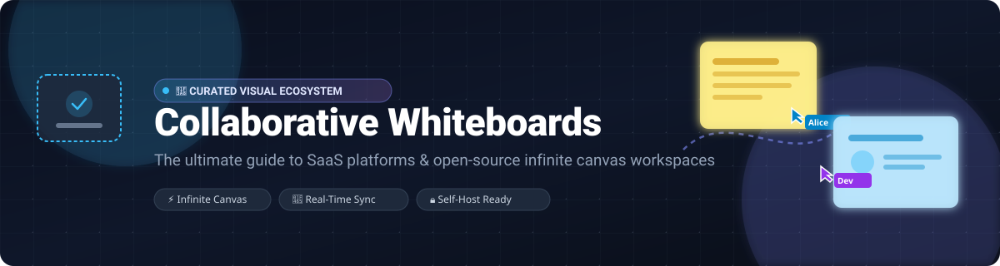

# 🎨 Awesome Online Collaborative Whiteboard

  

  
  
  
  
  
  

---

## 📌 Top Online Collaborative Whiteboard Ecosystem

**A Curated List of SaaS Platforms & Open-Source Infinite Canvas Workspaces**  
*Focused on Infinite Canvas, Real-Time Multiplayer Collaboration & Self-Hosted Visual Workspaces*  
**Last updated:** November 2026

Welcome to the comprehensive directory of **online collaborative whiteboards**, **visual collaboration suites**, and **infinite canvas software**. Whether you need an enterprise-grade digital whiteboard for cross-functional agile workshops or a self-hosted, end-to-end encrypted visual canvas, this guide compares features, company scale, transparent starting pricing, and exact free-tier limits.

---

## 📖 Table of Contents

- [📊 Sector Overview & Market Dynamics](#-sector-overview--market-dynamics)
- [☁️ SaaS & Hosted Whiteboard Platforms](#️-saas--hosted-whiteboard-platforms)
- [💻 Open-Source GitHub Projects](#-open-source-github-projects)
- [🤝 How to Contribute](#-how-to-contribute)
- [📈 Star History](#-star-history)
- [💖 Support](#-support)
- [⚖️ Disclaimer](#️-disclaimer)

---

## 📊 Sector Overview & Market Dynamics

The global collaborative whiteboard software market is valued at approximately **$2.6 billion to $3.1 billion** and is projected to expand to over **$7.5 billion by 2032**, registering a robust CAGR of ~14.8%. 

The market dynamics exhibit **moderate fragmentation transitioning toward an oligopoly**: general-purpose enterprise visual collaboration is dominated by heavyweight platform leaders (Cisco Webex, Atlassian, Canva, Miro, and Figma/FigJam), while nimble open-source and specialized local-first canvas engines (Excalidraw, AFFiNE, and Penpot) continue to capture significant developer, privacy-conscious, and self-hosted developer share.

---

## ☁️ SaaS & Hosted Whiteboard Platforms

*Ranked in descending order of company size (Market Capitalization / Enterprise Valuation).*

| Platform | Company Valuation / Revenue | Starting Paid Tier Pricing | Free Tier / Free Trial Limits | Key Focus & Strengths |
| :--- | :--- | :--- | :--- | :--- |
| **[Webex Whiteboard](https://www.webex.com/)** | **~$220B Market Cap** *(Cisco Systems)* | **$12.00 /user/month** *(Webex Meet plan billed annually)* | **Free forever plan:** Up to 100 meeting attendees, 40-minute meeting limit, and basic whiteboard access. | Enterprise visual canvas integrated directly with Cisco Webex conferencing gear, room kits, and secure meeting workflows. |
| **[Atlassian Whiteboards](https://www.atlassian.com/)** | **~$55B Market Cap** *(Atlassian Corporation)* | **$8.15 /user/month** *(Confluence Standard)* | **Free forever plan:** Free for up to 10 users across Jira & Confluence with unlimited whiteboards. | Deep bi-directional syncing with Jira issues, Confluence docs, smart sections, and sprint planning boards. |
| **[Canva Whiteboards](https://www.canva.com/)** | **~$26B Valuation** *(Canva Pty Ltd)* | **$12.99 /user/month** *(Canva Pro)* | **Free forever plan:** 3 free whiteboards, 5 GB cloud storage, and access to 1M+ free stock assets and templates. | Freeform collaborative brainstorms that blend directly into presentation slides, social media graphics, and print media. |
| **[Miro](https://miro.com/)** | **~$17.5B Valuation** *(RealtimeBoard, Inc.)* | **$8.00 /user/month** *(Starter plan billed annually)* | **Free forever plan:** 3 editable boards, unlimited team members, core template library, and basic integrations. | The benchmark enterprise infinite canvas platform featuring timers, voting, video chat, and 130+ app integrations. |
| **[FigJam](https://www.figma.com/figjam/)** | **~$12.5B Valuation** *(Figma, Inc.)* | **$3.00 /user/month** *(FigJam Standard billed annually)* | **Free forever plan:** 3 shared Figma/FigJam files with unlimited collaborators, music player, and plugins. | Intuitive diagramming and design sprints tightly connected to Figma design libraries, design tokens, and components. |
| **[Lucidspark](https://lucid.co/)** | **~$3.0B Valuation** *(Lucid Software Inc.)* | **$7.95 /user/month** *(Individual plan billed annually)* | **Free forever plan:** 3 editable Lucidspark boards, up to 60 objects per board, and basic collaboration features. | Brainstorming and workshop hub with native bi-directional integration into Lucidchart architecture diagrams. |
| **[Mural](https://www.mural.co/)** | **~$2.0B Valuation** *(Tactivos Inc.)* | **$9.99 /user/month** *(Team+ plan billed annually)* | **Free forever plan:** 3 active murals, unlimited team members, infinite canvas, and facilitation templates. | Purpose-built facilitation tool for agile ceremonies, design-thinking workshops, and structured guided team meetings. |
| **[Klaxoon](https://klaxoon.com/)** | **~$500M Valuation** *(Klaxoon SAS)* | **$9.00 /user/month** *(Starter plan billed annually)* | **Free forever plan:** 1 active whiteboard activity, up to 300 participants, and pre-built activity templates. | Engaging collaborative workshop suite featuring gamified quizzes, surveys, polls, and agile sprint boards. |
| **[Conceptboard](https://conceptboard.com/)** | **~$50M - $100M Valuation** *(Conceptboard GmbH)* | **$6.00 /user/month** *(Premium plan billed annually)* | **Free forever plan:** 1 board, 100 visual objects, 500 MB file storage, and unlimited participants. | GDPR-compliant European enterprise whiteboard platform designed for security-sensitive visual team collaboration. |
| **[Stormboard](https://stormboard.com/)** | **~$20M - $50M Valuation** *(Stormboard Inc.)* | **$8.33 /user/month** *(Business plan billed annually)* | **Free forever plan:** 5 active Storms (boards), up to 5 users per Storm, basic templates, and export tools. | Structured sticky note ideation and executive reporting engine that translates brainstorming into spreadsheets and decks. |
| **[Novastart](https://novastart.com/)** | Pre-revenue; bootstrapped | **$10/month** (Pro); **$20/user/month** (Team) | **Free plan available**; see website for current usage limits. | The Infinite Canvas Whiteboard OS: infinite canvas for apps, shared canvases, and AI agents on the canvas. Built with Rust. |

---

## 💻 Open-Source GitHub Projects

*Sorted by GitHub Stars_Count in descending order.*

- **[Excalidraw](https://github.com/excalidraw/excalidraw)**   
  The leading OSI-approved open-source virtual whiteboard (MIT). Features a distinctive hand-drawn aesthetic, infinite canvas with shapes, arrows, freehand, text, images, and real-time multiplayer collaboration via WebSocket (`excalidraw-room`). Includes component libraries, local-first in-browser rendering with minimal server footprint, and export to PNG, SVG, or native format.

- **[AFFiNE](https://github.com/toeverything/AFFiNE)**   
  An open-source, local-first knowledge base combining docs, infinite whiteboard canvas, and multidimensional tables in one unified workspace. Every page can toggle between structured document, whiteboard diagram, and database view. Offers offline-first local storage, AI-assisted mind mapping, and self-hosting with Docker.

- **[Penpot](https://github.com/penpot/penpot)**   
  Web-based open-source design and prototyping platform (MPL-2.0). Features an infinite collaborative visual canvas with native SVG support, flex/grid layouts, reusable components, interactive prototyping, and real-time multi-user editing.

- **[tldraw](https://github.com/tldraw/tldraw)**   
  A polished, Figma-like infinite canvas React SDK featuring rich shape and tool plugin architecture, sticky notes, multi-page support, snapping/alignment, and experimental AI sketch-to-code features. *Licensing Note*: Source-available (requires a license key for production use since SDK 4.0; free hobby/trial tiers available).

- **[Drawnix](https://github.com/plait-board/drawnix)**   
  An all-in-one open-source whiteboard (MIT) integrating mind mapping, flowcharts, freehand drawing, and diagramming on an infinite canvas. Built with modern web technologies, modular architecture, and multi-mode editing capabilities.

- **[draw.io (diagrams.net)](https://github.com/jgraph/drawio)**   
  Industry-standard open-source diagramming web application (Apache-2.0). Provides rich flowcharting, network architecture, UML, and process diagram editing with extensive stencil libraries and integrations with cloud storage and self-hosted environments.

- **[CryptPad Whiteboard](https://github.com/cryptpad/cryptpad)**   
  End-to-end encrypted collaboration suite (AGPL-3.0) with a dedicated whiteboard application. Client-side encryption ensures all drawings, sketches, and notes remain private and inaccessible to server administrators.

- **[Lorien](https://github.com/mbrlabs/Lorien)**   
  Infinite canvas drawing and note-taking application (MIT) built on the Godot engine. Focused on fast performance, smooth freehand brushstrokes, infinite canvas zoom/pan, cross-platform desktop support (Windows, Linux, macOS), and a distraction-free UI.

- **[OpenBoard](https://github.com/OpenBoard-org/OpenBoard)**   
  Open-source cross-platform interactive whiteboard application (GPL-3.0) designed for schools, universities, and presentations. Supports stylus pen tablets, interactive widgets, document annotation, podcasting/screen recording, and PDF imports.

- **[Whitebophir](https://github.com/lovasoa/whitebophir)**   
  Simple, lightweight, real-time collaborative whiteboard (AGPL-3.0) built with Node.js and WebSockets. Allows multiple users to draw simultaneously on a persistent board with zero setup friction and Docker deployment.

- **[Revezone](https://github.com/revezone/revezone)**   
  Lightweight, local-first graphic-centric productivity workspace (AGPL-3.0). Combines Excalidraw and Tldraw visual whiteboards with Notion-like structured markdown notes, bidirectional linking, and offline desktop sync.

- **[Spacedeck Open](https://github.com/spacedeck/spacedeck-open)**   
  Web-based, real-time collaborative whiteboard application (AGPL-3.0) with rich media support. Enables teams to arrange notes, shapes, audio, video, and documents collaboratively on infinite zoomable spaces.

- **[Whiteboard (cracker0dks)](https://github.com/cracker0dks/whiteboard)**   
  Lightweight collaborative whiteboard and sketchboard (MIT). Built with Node.js and HTML5 canvas, supports real-time co-drawing, undo/redo synchronization, image uploading, and simple self-hosting.

- **[OurBoard](https://github.com/raimohanska/ourboard)**   
  Lightweight online collaborative whiteboard with sticky notes, drawings, and images. Features instant real-time synchronization over WebSockets and simple deployment.

- **[Nextcloud Whiteboard](https://github.com/nextcloud/whiteboard)**   
  Collaborative infinite canvas whiteboard integrated directly into the Nextcloud ecosystem (AGPL-3.0). Supports shapes, drawing, sticky notes, and seamless integration with Nextcloud Files and permissions.

- **[Tableau Noir](https://github.com/tableaunoir/tableaunoir)**   
  Interactive online blackboard and whiteboard (GPL-3.0) designed for teaching, tutoring, and presentations. Offers virtual fridge magnets, multi-board pagination, recording, and smooth drawing in a lightweight UI.

- **[Diwan](https://github.com/vul-os/diwan)**   
  Self-hostable collaborative office suite shipped as a single Go binary (Apache-2.0 / MIT). Features an Excalidraw-based whiteboard with CRDT peer-to-peer sync and end-to-end encryption over WebRTC, alongside docs and spreadsheets.

---

## 🤝 How to Contribute

Contributions are warmly welcomed! Help make this curated whiteboard directory even better:

1. 🍴 **Fork** the repository.
2. 📝 **Add/edit** entries in `README.md` following the established table and list formatting.
3. 🔍 **Include** verified details: platform name, link, specific pricing, free tier limits, and open-source license.
4. 🚀 **Submit** a pull request with a concise summary of your addition.

---

## 📈 Star History

---

## 💖 Support

If you find this curated collection valuable, please consider supporting the project:

- ⭐ **Star** this repository to help other engineers and teams discover it.
- 🍴 **Fork** and contribute new tools, updates, and benchmarks.
- 📢 **Share** it with your fellow developers, product designers, and agile facilitators.
- ☕ **Buy me a coffee / Sponsor**: If you'd like to support ongoing maintenance and new curated ecosystems, visit the [GitHub Sponsor Dashboard](https://github.com/sponsors/ishandutta2007). Thank you for your support! 🙌

---

## ⚖️ Disclaimer

- This is an independent, community-curated directory — not an endorsement of any commercial platform or company.
- Collaborative whiteboard platforms handling sensitive team documents, blueprints, and meeting records must align with organizational data privacy and compliance guidelines. **Self-hosted software places full operational responsibility (backups, security, and uptime) on the operator**.
- **Licensing Alert**: True open-source solutions (e.g., Excalidraw, Penpot, Drawnix) offer unrestricted OSI-compliant licenses, whereas projects like tldraw follow a source-available commercial model requiring paid licensing for production software deployments.

---

  <b>Built with ❤️ for product teams, visual thinkers, facilitators, and software architects worldwide.</b>

